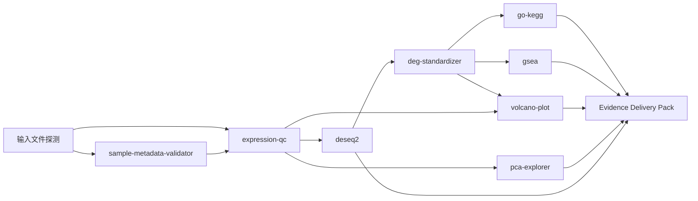

# 第一个科学问题：bulk RNA-seq 差异表达证据链

## 1. 科学问题

> 在给定的实验设计和样本质量前提下，处理条件是否导致可靠的基因表达变化？这些变化是否得到 GO/KEGG/GSEA 功能通路证据支持？

这个问题适合做第一条 Harness 真实任务基线，因为它同时覆盖：模糊需求澄清、文件结构探测、R 包环境准备、多个插件 DAG、Artifact lineage、统计结果展示、失败恢复和可复现交付。

## 2. 模块 DAG



执行顺序不是聊天文本串联，而是 valid artifact lineage：下游插件只能绑定上游 Job 已验证、类型匹配的 Artifact。

## 3. 独立插件边界

每个插件都是独立可发现、独立执行、独立验收的科学分析模块：

| 插件 | 科学子问题 | 输入 | 关键输出 | 依赖策略 |
|---|---|---|---|---|
| `sample-metadata-validator` | 样本、分组和 contrast 是否可用于设计 | counts 表头、metadata | schema diagnostics、对齐后的 metadata、设计摘要 | R base + jsonlite，优先无重 bundle |
| `expression-qc` | 样本质量和表达矩阵是否适合建模 | counts + validated metadata | library size、过滤统计、相关性、PCA、QC report | ggplot2/pheatmap；必要时独立轻量 bundle |
| `deseq2` | 处理条件是否造成差异表达 | validated counts + metadata + design/contrast | DEG table、诊断图、PCA、MA、heatmap、report | `r-deseq2` 或已验证 R capability |
| `deg-standardizer` | 差异结果能否作为稳定下游输入 | DESeq2/limma valid table | 标准 DEG table、up/down tables、统计摘要 | 轻量 R bundle 或运行时基础包 |
| `volcano-plot` | 差异结果的效应量/显著性如何分布 | standardized DEG table | volcano plot、plot data、report | ggplot2/ggrepel |
| `pca-explorer` | 样本分离是否与设计或批次一致 | expression matrix + metadata | PCA coordinates、variance、plot、diagnostics | ggplot2 |
| `go-kegg` | 显著基因的功能类别是否富集 | standardized DEG table | GO/KEGG tables、plots、report | `r-enrichment` |
| `gsea` | 全基因排序是否支持通路方向性 | ranked DEG table | GSEA table、plots、report | `r-enrichment` |

插件独立不等于插件互不关联：关联通过 `bind_artifact` 和 lineage 建立，而不是复制文件或共享聊天变量。

## 4. 开发顺序

### Phase A：输入和质量门

1. `sample-metadata-validator`
2. `expression-qc`

出口：能明确回答“数据是否具备建模条件”；无法对齐时结构化阻断，不进入 DESeq2。

### Phase B：差异模型和标准结果

1. 按原型规范完善 `deseq2`
2. 新增 `deg-standardizer`

出口：产生唯一、可绑定、带输入/参数/环境 provenance 的标准 DEG Artifact。

### Phase C：展示和功能证据

1. 完善 `volcano-plot`
2. 完善 `pca-explorer`
3. 完善 `go-kegg`
4. 完善 `gsea`

出口：所有图表均可由独立脚本重放，空结果和低映射率均有明确解释。

### Phase D：Evidence Delivery Pack

这不是普通分析插件。它把多个 Artifact 组织成论据：统计事实、图表、方法、限制和复现入口。

## 5. 每个插件的统一开发内容

每个模块都必须从原型复制并补齐：

```text
plugin.json
tool-definition.json
environment.json
scripts/<id>.R
demo-data/
<id>-report-template.html
README.md
acceptance.json
```

每个 Job 必须保存：`run-script.R`/`run-script.py` 快照、脚本 SHA-256、输入 Artifact 引用和输入 SHA-256、规范化参数和参数 hash、runtime/R 包/bundle 版本、输出 Artifact 和输出 SHA-256、失败诊断和 lineage。

## 6. OSS 分发边界

不是所有插件运行结果都上传 OSS。

| 内容 | 开发阶段 | 正式分发 |
|---|---|---|
| 插件源代码和模板 | 本地目录 | 可打包成 installed plugin，上传 OSS 或其他受控分发源 |
| 插件 zip | 不需要上传 | 上传后必须有 URL、SHA-256、大小和平台 artifact |
| R/Python capability bundle | 本地可用时不上传 | 重包通过 OSS 分发；按平台独立构建和校验 |
| 用户输入数据 | 保存在用户本地项目 | 默认不上传 OSS |
| Job 结果、图、表、报告 | 保存在本地 Job/project 目录 | 默认不上传；只有用户明确导出/分享才进入外部存储 |
| artifact-manifest / provenance | 本地必须保存 | 可随结果导出，但不能脱离权限和项目作用域 |

内置插件使用 `built-in://<id>`，随应用发布，不需要运行时从 OSS 下载插件代码。商店/installed 插件才使用真实 URL + SHA-256。重量级 R bundle 可以从 OSS 按需下载，但必须经过：

```text
平台选择 → https/host 白名单 → SHA-256 校验 → 解包 marker 校验 → R_LIBS_USER 挂载 → readiness 证据
```

当前仓库的 `r-enrichment` 和 `r-wgcna` 已有 macos-arm64 capability descriptor；新增平台或版本必须补自己的已验证 descriptor，不能复用其他平台包。

## 7. 首条任务验收标准

该科学问题的第一条完整验收必须证明：

1. 小白只描述“比较处理组和对照组，找差异基因和通路”，Agent 能生成任务草案。
2. 文件探测能定位 counts 和 metadata，并发现样本名/分组问题。
3. `sample-metadata-validator` 失败时不会盲跑 DESeq2。
4. `expression-qc → deseq2 → deg-standardizer → go-kegg/gsea` lineage 可重放。
5. 每个图、表和报告都有独立脚本入口或明确依赖链。
6. 同输入、同参数、同 runtime 的确定性表格结果 hash 一致；图像使用声明的数值容差。
7. 任一插件失败都能映射到结构化 failure mode，并给出下一步修复。
8. 缺少 R bundle 时进入 `runtime_not_ready`，不在脚本内偷偷安装。
9. macos-arm64 通过真实运行；其他平台明确为 planned 或 `platform_not_supported`。
10. 最终交付包含论据、限制、脚本快照、参数、输入 hash、环境和复现命令。

## 8. 回到 Harness 主线

这条任务链完成后，不继续无限增加插件。将运行记录写入 HRT-0 夹具和指标文件，重点评估模糊需求转任务契约、Agent 自动化/确认/阻断边界、文件定位、Artifact lineage、失败恢复、脚本复现、资源和成本提示。

插件开发的出口是为 Harness 提供真实科学任务证据，而不是形成第二套工作流系统。
